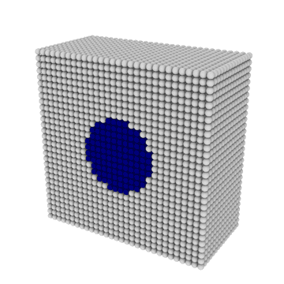

# Multiphase SPH for LAMMPS

Multiphase SPH (color gradient, surface tension, phase change) for
current LAMMPS. Tested with LAMMPS 30 Sep 2026.

<p align="center"></p>

## Build with make

```
cp MULTIPHASE/*.cpp MULTIPHASE/*.h lammps/src/
cd lammps/src
make yes-SPH
make -j mpi
```

## Build with CMake

```
cp MULTIPHASE/*.cpp MULTIPHASE/*.h lammps/src/
mkdir lammps/build && cd lammps/build
cmake ../cmake -D PKG_SPH=on
cmake --build . -j
```

## Input

```
atom_style  sph
create_box  2 box
mass        * 1.0
fix         mp all property/atom rmass d2_cg 3 ghost yes
```

## Styles

- pair: `sph/rhosum/multiphase`, `sph/colorgradient`, `sph/taitwater/multiphase`,
  `sph/surfacetension`, `sph/heatconduction/multiphase`, `sph/heatconduction/phasechange`
- fix: `phase_change` (optional `convert CV`: a drained liquid particle becomes vapour)
- compute: `sph/de/atom`

## Examples

- `two_atoms`: two-particle tests against maxima (`maxima -b X.mac`, then `lmp_mpi -in X.lmp`)
- `square_to_sphere`: square droplet relaxing under surface tension
- `droplet_grid`, `contact_angle`: droplet oscillation and wetting
- `bubble_growth`, `bubble_random`, `bubble_on_wall`: boiling with phase change
- `droplet_evaporation`: droplet evaporating in hot vapour

Run with `LMP=lmp_mpi bash run.sh` in the example directory.
