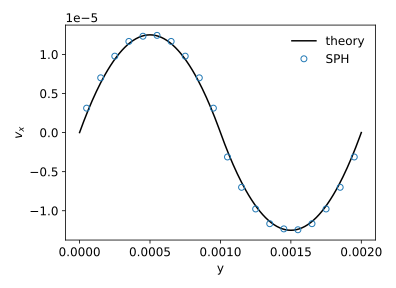
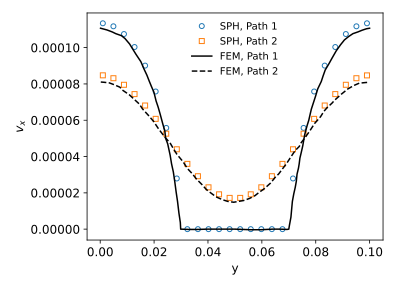
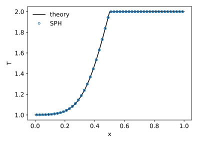
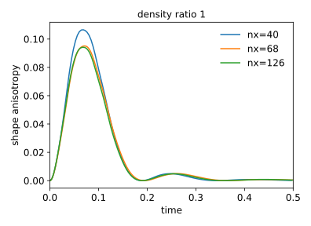
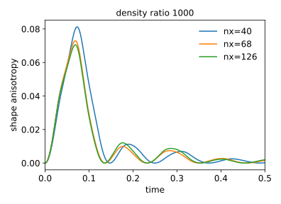
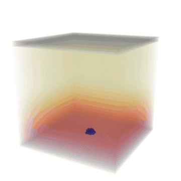
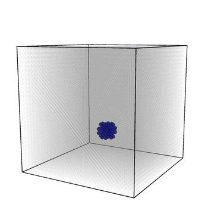

# SPH with phase change for LAMMPS

Boiling and evaporation with multiphase SPH (color gradient, surface
tension) for current LAMMPS.

## Build with make

```
cp MULTIPHASE/*.cpp MULTIPHASE/*.h lammps/src/
cd lammps/src
make yes-SPH
make -j mpi
```

## Build with CMake

```
cp MULTIPHASE/*.cpp MULTIPHASE/*.h lammps/src/
mkdir lammps/build && cd lammps/build
cmake ../cmake -D PKG_SPH=on
cmake --build . -j
```

## Input

```
atom_style  sph
create_box  2 box
mass        * 1.0
fix         mp all property/atom rmass d2_cg 3 ghost yes
```

## Styles

- pair: `sph/rhosum/multiphase`, `sph/colorgradient`, `sph/taitwater/multiphase`,
  `sph/surfacetension`, `sph/heatconduction/multiphase`, `sph/heatconduction/phasechange`
- fix: `phase_change` (optional `convert CV`: a drained liquid particle becomes vapour)
- compute: `sph/de/atom`

## Examples

- `two_atoms`: two-particle cases
- `square_to_sphere`: square droplet relaxing under surface tension
- `droplet_grid`, `contact_angle`: droplet oscillation and wetting
- `bubble_growth`, `bubble_random`, `bubble_on_wall`: boiling with phase change
- `droplet_evaporation`: droplet evaporating in hot vapour
- `poiseuille`, `flow_around_cylinder`, `slub`: validation
- `bubble_rise`: vapour bubble growing and rising under gravity

Run with `LMP=lmp_mpi bash run.sh` in the example directory.

## Validation

Reverse Poiseuille flow [1]

<p align="center"></p>

Flow around a cylinder, Re=0.03, compared with FEM [1]

<p align="center"></p>

Heat conduction in an infinite slab [2]

<p align="center"></p>

Droplet oscillation under surface tension [3]

<p align="center"> </p>

1. Morris, Fox, Zhu, J. Comput. Phys. 136, 214 (1997)
2. Cleary, Monaghan, J. Comput. Phys. 148, 227 (1999)
3. Hu, Adams, J. Comput. Phys. 213, 844 (2006)

<p align="center">  </p>
